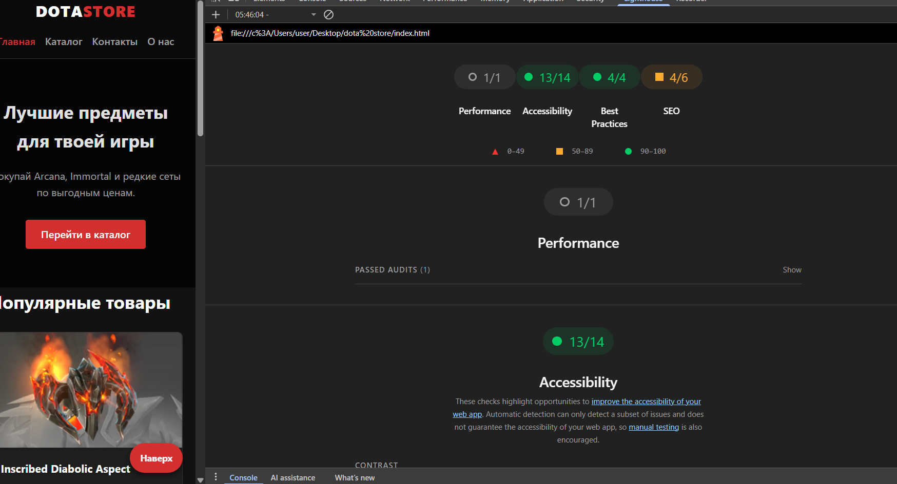

# Проект: Адаптивная верстка сайта Dota 2 Store (КР №3)
Данный проект является доработкой контрольной работы №1. Сайт адаптирован под различные размеры экранов (мобильные, планшеты, десктоп) и проверен на базовую доступность.

## Выполненные требования:
- [x] **Адаптивность:** Использованы медиа-запросы в отдельном файле `css/responsive.css` для перестройки сеток, навигации и карточек.
- [x] **Viewport:** Добавлен тег `<meta name="viewport">` для корректного масштабирования на мобильных устройствах.
- [x] **Респонсивные изображения:** Настроено свойство `max-width: 100%; height: auto;`, чтобы картинки не вылезали за пределы экрана.
- [x] **Доступность (Accessibility):** 
  - Присутствует семантическая верстка.
  - Добавлены `alt`-тексты для изображений.
  - Добавлены стили `:focus-visible` для удобной навигации с клавиатуры (Tab).
- [x] **Lighthouse:** Проверка показателей скорости и доступности.

## Скриншот Lighthouse

## Демо (GitHub Pages)
[Ссылка на ваш сайт будет здесь]